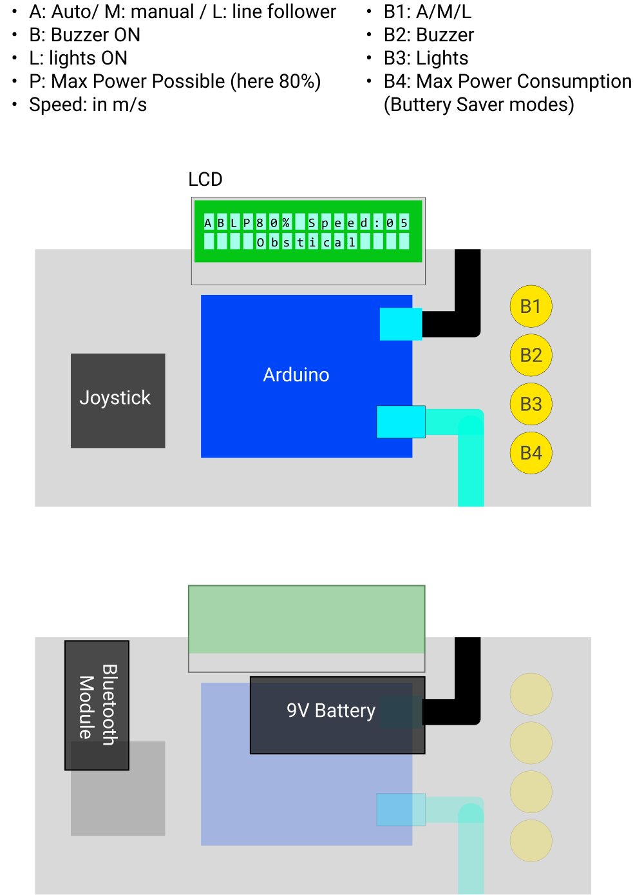
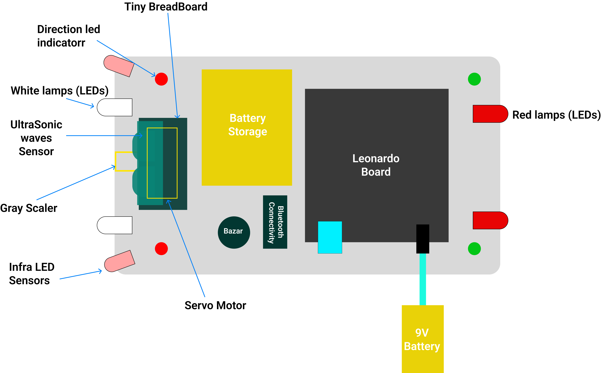
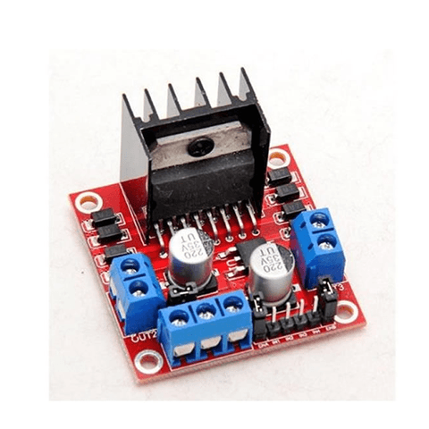

# SmartCarUniPrj

## Project Overview

This project was developed by:

- **Lawrence Abou Karroum** ([Personal Website](https://lawrence-abou-karroum.web.app/), [LinkedIn](https://www.linkedin.com/in/lawrence-abou-karroum/))
- **Ahmad Mansour** ([LinkedIn](https://www.linkedin.com/in/ahmad-mansour-48489a2b9/))
- **Majd Nasrallah** ([LinkedIn](#))
- **Ziad Hamede** ([LinkedIn](#))

It was our final project for the **Embedded Systems Lab** course at the University of Balamand. The goal was to develop a smart robotic car capable of operating in three different modes, all of which were successfully implemented and tested. These modes are explained in detail below.

The following image shows the final result of the project:

You can also check out this short video on my YouTube channel for a quick glimpse of the final result:

[Watch the project demonstration on YouTube](https://www.youtube.com/shorts/GpCHDOonlNM)

**Project completion date:** May 30, 2024.

---

## Repository Structure

This repository is divided into three main sections:

### 1. Controller

This folder contains the code for the car's remote controller. It allows the user to control the car manually and switch between its operating modes, which are explained below.

See the following image:

### 2. RobotCar

This folder contains the code running on the robotic car. It allows the car to navigate autonomously, avoid obstacles, and follow a line.

See the following image:

### 3. Tunel

This folder contains the code for the car's autonomous navigation system. During development, this code was written and tested separately before being integrated with the other components. I left it in the repository for reference.

---

## Robot Operating Modes

The smart car supports three operating modes:

1. **Line Following:** The car follows a dark line using grayscale sensors and stops when it reaches the end of the path.

2. **Manual Control:** Allows the user to control the robot just like a remote-controlled car. This mode is particularly useful when the robot needs direct instructions to perform a specific task. It was also frequently used during testing and debugging to help the robot recover when it got stuck.

3. **Automatic Object Avoidance:** Allows the robot to navigate its surroundings autonomously by detecting and avoiding obstacles, without requiring a predefined destination.

---

## Hardware and Technical Details

This project consists of two main components: a robotic car and its remote controller.

### The Robotic Car

The robot is built around an **Arduino Mega**, which acts as its main controller. It communicates with the Arduino Uno inside the remote controller through two HC-05 Bluetooth modules.

The Bluetooth module on the controller is configured as the **Master**, while the module on the robotic car is configured as the **Slave**.

The robot is equipped with an **HC-SR04 ultrasonic sensor**, as shown in the figure below, which is responsible for detecting obstacles during autonomous navigation.

The initial car design also included infrared sensors, as illustrated in the original drawing. However, these were later replaced by a **Tower Pro SG90 9g micro servo motor**.

The ultrasonic sensor was mounted on the servo motor, allowing it to rotate through approximately 180 degrees while continuously measuring distances. This gave the car a radar-like scanning capability, enabling it to detect obstacles in different directions rather than only directly in front of it.

Additionally, the car is equipped with three grayscale line-detection sensors. These sensors detect dark-colored lines and allow the robot to follow a predefined path. They are positioned as follows:

- **Left sensor:** Detects whether a line is present on the left.
- **Middle sensor:** Detects whether a line is present in the middle.
- **Right sensor:** Detects whether a line is present on the right.

If none of the three sensors detects the line, the robot considers that it has reached the end of the path and stops.

### Power Supply

The car operates using two separate power sources:

- The motors are powered by an external lithium-ion battery supply.
- The Arduino Mega is powered through a 9V battery connected to its DC power jack.

This separation helps maintain the stability of the microcontroller and its connected components while allowing the motors to receive the power they require.

### LEDs and Buzzer

As an additional touch, we installed white LEDs at the front and red LEDs at the back of the car. This made it easier to distinguish the front from the rear, especially when the car was moving away from us.

A buzzer was also added and played an important role during testing. It was used to indicate successful connections between the controller and the car. Both the LEDs and the buzzer also added an artistic and practical touch to the project.

### Motor Speed Control

To allow longer testing sessions and reduce battery consumption, we implemented three selectable speed levels:

- **60%:** Approximately half of the maximum speed the car can reach.
- **80%:** A higher speed, approaching the maximum speed the car can reach.
- **100%:** The maximum speed the car can reach.

To better understand what these percentages represent, we first need to explain how the motor control circuit works.

#### L298 H-Bridge

As shown in the image above, the red component mounted on the car is the **L298 H-Bridge motor driver**.

This component allows the Arduino Mega to control the motors by regulating the power delivered from the lithium-ion batteries to them. It also allows the Arduino to control the motors' direction and speed.

Using a dedicated motor driver allows the motors to receive the higher current they require without drawing that current directly from the Arduino. Meanwhile, the Arduino Mega and its connected sensors and LEDs are powered separately through the 9V supply, helping maintain system stability.

#### Pulse Width Modulation (PWM)

The Arduino Mega uses **Pulse Width Modulation (PWM)** to control the motors' speed.

PWM works by rapidly switching the power delivered to the motors ON and OFF. The percentage of time the signal remains ON during each cycle is called the **duty cycle**.

The three speed levels correspond to the following duty cycles:

- **60% speed:** A duty cycle of \(D = 0.6\), meaning the signal remains ON for 60% of each PWM cycle.
- **80% speed:** A duty cycle of \(D = 0.8\), meaning the signal remains ON for 80% of each PWM cycle.
- **100% speed:** A duty cycle of \(D = 1.0\), meaning the signal remains ON continuously.

At 100%, the motor driver receives a continuous control signal, allowing the motors to operate at their maximum available power.

---

## The Remote Controller

The controller is built around an **Arduino Uno** and consists of a joystick, five buttons, an LCD screen, a Bluetooth module, a buzzer, and a 9V battery.

The joystick is used to control the direction of the car when operating in Manual Mode.

The five buttons serve the following purposes:

1. **Mode Button:** The top button is used to navigate between the available operating modes (Automatic Object Avoidance, Manual Control, and Line Following).

2. **Buzzer Button:** This button activates the buzzer on the car. You may notice in the project image that the controller also has its own buzzer. It was added to replicate the sound of the car's buzzer. This way, if the car is far away and its buzzer cannot be heard, the controller's buzzer can still inform us that the buzzer has been activated.

3. **Lights Button:** Toggles the lights on the car, including both the front and rear LEDs.

4. **Speed Button:** Controls the power delivered to the motors and, consequently, the car's speed. This was particularly useful during testing, as reducing the speed helped extend the battery life and allowed us to perform more tests per charge.

5. **OK Button:** Used to confirm selections, particularly when choosing an operating mode. The reason this button was necessary will become clearer in the explanation of the operating process below.

An **LCD screen** was also integrated into the controller to display information and the current system state. The Bluetooth module handles communication with the robotic car, while a 9V battery powers the Arduino Uno and the controller's components.

---

## How It All Works

When the car and controller are powered on, their Bluetooth modules immediately start scanning and attempting to establish a connection with each other.

Once the connection is successfully established, the car's buzzer beeps to indicate that communication between the two devices is active.

By default, the car starts in **Manual Mode**, with its other operating functions initially inactive.

### Mode Selection

When the user presses the Mode button, the LCD screen displays the first available mode, which is Automatic Object Avoidance.

Pressing the Mode button again moves to the next available mode, which is Line Following. Pressing it once more cycles through the available modes.

Once the desired mode appears on the LCD screen, pressing the OK button confirms the selection and activates that mode.

To cancel a selection, the user can simply select the currently active mode again. Since the controller does not include a dedicated Cancel button, this approach was adopted to keep the design simple and avoid requiring additional buttons, given the limited available space and resources.

### Reset Button

It is also worth noting that the yellow button on the robotic car was primarily included to provide easy access to the reset function of the Arduino Mega. This was particularly useful during testing and debugging.

---

## Additional Notes

None of the products or components shown in the images above are sponsored. The images are presented as they are, including their original brand names and logos.